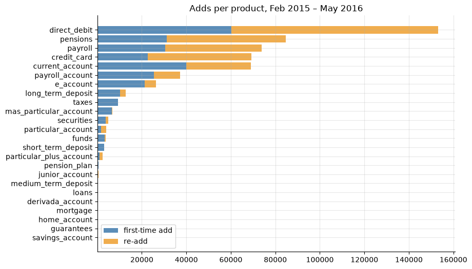
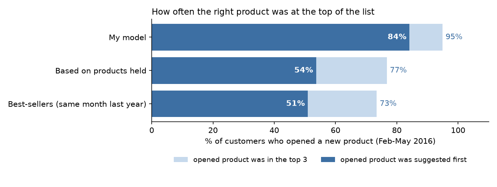
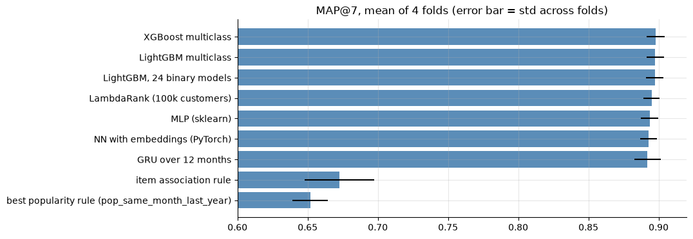

# Which bank product will a customer open next?

A bank sells 24 products, from current accounts to pensions and credit cards. Every month a small share of
customers open something new. If the bank knew in advance who is likely to open what, it could offer each customer
the product that fits them instead of pushing the same best-sellers to everyone.

Using 17 months of anonymised data from the Spanish bank Santander (a public Kaggle dataset), I built a model that
does this. For customers who opened a new product, **the model's first suggestion was the right one 84% of the
time**, compared with about 51% when suggesting last year's
best-sellers for the same month.

## Summary

- **The problem:** for each of 930,000 customers, list the products they are most likely to open next month, best
  first.
- **The result:** the right product came first for 84% of customers who opened one, and was in the top three for
  95%. Simple rules reach 51% to 54%.
- **What drives it:** what a customer already holds matters more than age, income or region. Comebacks to a
  dropped product are the easiest to predict.
- **How a bank could use it:** cross-sell by what customers hold, win back dropped products, time tax
  campaigns, and reach out after life changes (such as a student starting work). All still need a live test.

The full technical write-up is in [`story.ipynb`](story.ipynb).

## The data

The data is a monthly snapshot of every customer from January 2015 to May 2016: which of the 24 products they hold,
plus basic profile information such as age, how long they have been a customer, region and income.

Here is one real customer's credit card over those months:

| Jan–Mar 2015 | Apr–Jun 2015 | Jul 2015 | Aug 2015–Jan 2016 | Feb–Mar 2016 | Apr 2016 | May 2016 |
|---|---|---|---|---|---|---|
| no card | card | no card | card | no card | card | no card |

The same customer also held a salary account, a mortgage and a pension the whole time, and added a long-term
deposit and a fund in May 2015. Opening a product, letting it go and opening it again turns out to be very common.

In total there are 13.6 million monthly records for about 956,000 customers.

## What I found first



- **Opening a new product is rare:** in a typical month only about 3.6% of customers open anything.
- **A few products dominate:** direct debit, pensions, payroll, credit cards and current accounts make up 80% of
  all new products.
- **More than half are comebacks:** 55% of new products are ones the customer had held before (orange in the
  chart).
- **The data has traps:** for the first seven months, profile details such as age were copied backwards from July
  2015, so they never change, which would mislead a model. I recomputed seniority from the contract start date.
- **Some products are seasonal:** tax-related products jump in April in both years and peaked in June 2015,
  at 7% of all new products compared with about 1% in a normal month.

## The question

For each customer, rank the products they do not have yet by how likely they are to open each one next month, and
keep the top seven.

To score a list, I look at where the product the customer really opened sits in it. First place gets full marks,
second place half, third place a third, and so on. Averaged over customers, this is the competition's metric,
MAP@7. I also report the simpler "was it first?" rate, because it is easier to picture.

## How I approached it, and why

- **Always test on the future:** train on earlier months, test on a later month the model has never seen, just
  as it would be used. Shuffling months together would let it peek at the future and look better than it is.
- **Test on four different months, not one:** results move from month to month. Testing February, March, April and
  May 2016 separately shows whether a gain is real or just a good month.
- **Start with the simplest answer:** before any model, I measured what you get by suggesting best-sellers to
  everyone. Anything more complex has to beat that clearly.
- **Use only what is known at the time:** every input is something the bank would know at the end of the previous
  month.
- **Only keep changes that are clearly better:** training the same model again, with nothing changed but its random
  starting point, moves the score by about 0.001, so that is what luck looks like. An idea had to beat that and
  win in nearly every month I tested. Only one did: recent changes in a customer's profile (8 out of 8).
- **Prefer simple and explainable:** I tried two common families of models, decision trees and neural networks. They
  landed within 0.006 of each other, about the size of month-to-month noise, so I chose a single LightGBM
  model (a widely used decision-tree method): fast, simple and easy to explain.

## Results



| | Right product first | In the top 3 | MAP@7 |
|---|---|---|---|
| Best-sellers (same month last year) | 51% | 73% | 0.652 |
| Based on products already held | 54% | 77% | 0.673 |
| **My model** | **84%** | **95%** | **0.898** |

These are averages over the four test months, for customers who opened at least one product.

## Key findings

- **What you hold predicts what you open next:** customers with a salary account often go on to a pension or
  payroll product. This "basket" signal matters more to the model than age, income or region.
- **Comebacks are easy, first-timers are hard:** when a customer reopens a product they once had, the model puts it
  first 95% of the time. For a product they have never had, only 66%.
- **Quiet customers are the hardest:** customers with no changes for five months are 29% of customers who opened a
  product but account for 52% of the points the model loses. Life changes help: students who just started working
  opened a product 2.6 times as often as other students (4.2% against 1.6%).
- **Importance is not the same as impact:** an explainability tool (SHAP) said sex and nationality barely
  mattered, yet switching sex alone changed the top suggestion for 8.4% of customers. Removing them barely
  changed accuracy.

## How a bank could use this

| What the data showed | What a bank could do |
|---|---|
| The products a customer already holds are the best clue to what they open next. | Base cross-sell offers on what each customer holds, not on what sells best overall. |
| Customers often come back to products they dropped, and the model gets these right 95% of the time. | Run win-back offers for recently dropped products: the most accurate group. |
| Tax products jump in April in both years and peaked in June 2015. | Time tax-product campaigns around the tax season. |
| Students who start working open new products 2.6 times as often. | Use life changes like this as a reason to get in touch. |
| A second suggestion raises the chance that the right product is on the list from 84% to 92%. A third adds less than 3 points more. | Where the channel has room (app, email), show two suggestions by default, and test whether customers respond more. |
| Removing sex and nationality barely changed accuracy. Before, switching sex alone changed the top suggestion for 8.4% of customers. | Leave them out of recommendations: accuracy stays about the same, and customers who would rather not share them lose nothing. |

These are proposals, not measured results. Two steps would come first: a model that picks *who* to contact (most
customers open nothing in a given month), and a small A/B test: offer the new suggestions to one group and the
current ones to another, then compare how many products each group opens.

## Lessons learned

- **Check the data before trusting it:** the copied-back profile months looked normal at first glance and would
  have misled the model.
- **Most ideas do not help:** writing down every failed experiment kept me from keeping ideas that only looked good
  by chance.
- **A better score is not yet a business result:** it shows the suggestions are more accurate, not that customers
  will take them up; only a live test can show that.

## Limits

The data covers only 17 months, so yearly patterns appear once (June) or twice (April). I cannot tell whether they
repeat every year, and the model learned June from a single example.

---

## For technical readers

**Kaggle (late submission):** 0.02740 private / 0.02713 public; the winning private score was 0.03140. Kaggle
averages over *all* test customers and non-adders score 0, so these numbers are on a different scale from MAP@7
above. Every setting was chosen on my own validation folds, never from leaderboard feedback.



### Repository layout

```
story.ipynb             the technical write-up (charts and tables are saved in the file)
santander/              shared code: column names, loading + MAP@7 evaluation, the final feature set,
                        and the analysis functions the notebook calls
pipeline/               data cleaning -> target -> features -> final model and submission
experiments/            scripts behind the saved results in analysis_output/ (model comparison,
                        experiment log, hyperparameter search, explainability, the README numbers)
analysis_output/        saved results read by the notebook
models/                 the final model, and version 1 (with sensitive columns) used by the XAI checks
docs/                   the charts in this README
```

**What you need, and what is optional:**
- **Core code:** `santander/` and `pipeline/`. They are enough to build the data, train the final model, write the
  submission and run the notebook.
- **`experiments/` (optional):** the record of how the saved results in `analysis_output/` were produced:
  the experiment log (§8), the model comparison (§9, incl. the current settings from the hyperparameter
  search) and the XAI comparison (§11). You do not need to run it to read or run the notebook. Each script trains
  models, and takes minutes to hours.

### Getting the data

1. Sign in to Kaggle, open the
   [competition data page](https://www.kaggle.com/competitions/santander-product-recommendation/data) and accept the
   competition rules. The rules do not allow the data to be redistributed, so it is not in this repository.
2. Download it, either from that page or with the Kaggle CLI (`pip install kaggle`, with an API token in
   `~/.kaggle/kaggle.json`):
   ```bash
   kaggle competitions download -c santander-product-recommendation
   unzip santander-product-recommendation.zip
   unzip train_ver2.csv.zip && unzip test_ver2.csv.zip      # keep sample_submission.csv.zip zipped
   ```
3. The project folder (this repository's root) should then contain `train_ver2.csv` (2.3 GB, 13.6M rows),
   `test_ver2.csv` and `sample_submission.csv.zip`.

### Setup

```bash
python3.11 -m venv .venv && source .venv/bin/activate
pip install -r requirements.txt          # on macOS first: brew install libomp
```

### Running the pipeline

Run each step from the repository root as a module (`python -m pipeline.make_features`), in this order.
Steps 1–4 build `processed/`, which the notebook needs.

| step | script | output |
|---|---|---|
| 1 | `pipeline/make_clean_parquet.py` | `processed/train_clean.parquet`, `processed/test_clean.parquet` (English column names via `santander/column_map.py`) |
| 2 | `pipeline/make_target_table.py` | `processed/target.parquet` (which products each customer added each month) |
| 3 | `pipeline/make_features.py` | `processed/features_{train,test}.parquet` (166 features, adder rows only for train) |
| 4 | `pipeline/make_profile_change.py` | `processed/profile_change_{train,test}.parquet` (profile lags, set B) |
| 5 | `santander/final_features.py` | not run directly: the final 175-feature list and LightGBM parameters |
| 6 | `pipeline/final_train_predict.py` | `models/final_lgbm.txt`, `submission/submission.csv` |
| 7 | `pipeline/check_submission.py` | independent checks of the submission against the raw data |

Shared code lives in `santander/`: `train_common.py` (loading, MAP@7 evaluation), `final_features.py` and
`story_analysis.py` (the analysis functions the notebook calls).

### Running the notebook

After steps 1–4, open `story.ipynb` and run all cells (under a minute). The notebook does two things:

- **Computes live from `processed/`:** the data, target and baseline tables and the SHAP / counterfactual checks.
  The SHAP and counterfactual checks use the saved models in `models/`.
- **Reads saved results from `analysis_output/` (committed):** results of model training (comparison, experiment
  log, XAI comparison). Nothing is retrained in the notebook.

**Optional: where the saved results come from.** These are the scripts in `experiments/`. Run them as modules, e.g.
`python -m experiments.run_change`.

| results | script |
|---|---|
| `analysis_output/models/top1_hits.csv`, `top1_by_add_type.csv`, `close_calls.csv`, `quiet_customers.csv` (numbers in this README) | `top1_hits.py` |
| `analysis_output/models/feat_experiments.csv` | `run_feat.py` |
| `analysis_output/models/lag_experiments.csv` | `python -m pipeline.make_features --nlag 12`, then `run_lagsets.py` |
| `analysis_output/models/change_experiments.csv` | `run_change.py` |
| `analysis_output/models/sensitive_ablation.csv`, `month_ablation.csv` | `ablate_sensitive.py`, `ablate_month.py` |
| `analysis_output/models/extra_models.csv` | `compare_extra.py logreg` |
| `analysis_output/tuning/` | `tune.py` (driver: `experiments/run_tuning.command`), summary: `tune_summary.py` |
| `analysis_output/models/lgbm_val*_scores.npy` (error analysis) | `run_lgbm.py --val-month 13..16` |
| `analysis_output/xai/` | `xai_shap.py`, `xai_part2.py`, `train_compare_models.py`, `xai_compare.py` |
| `analysis_output/model_comparison.csv` | assembled by hand from the per-fold result files of `run_lgbm.py`, `run_extra.py`, `run_rank.py`, `run_mlp.py`, `run_nn.py`, `run_gru.py`; no single script |
